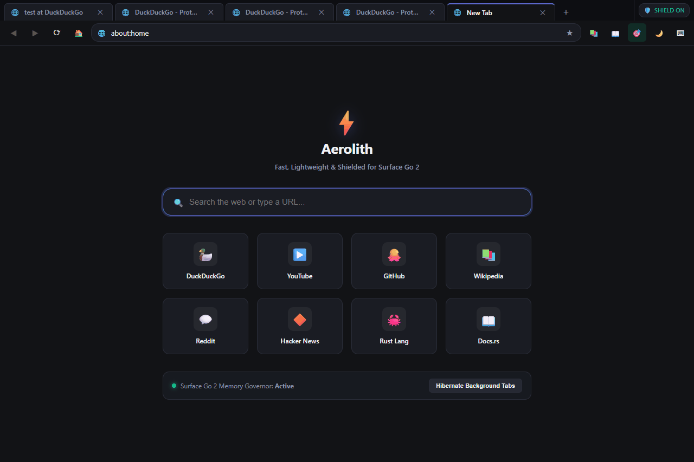
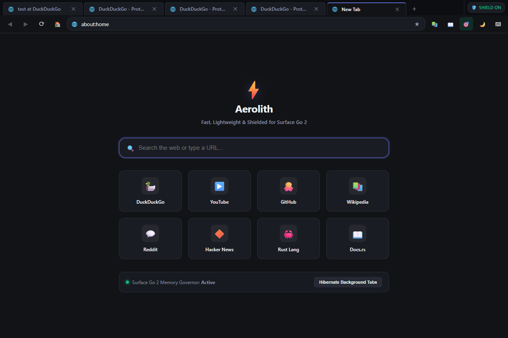
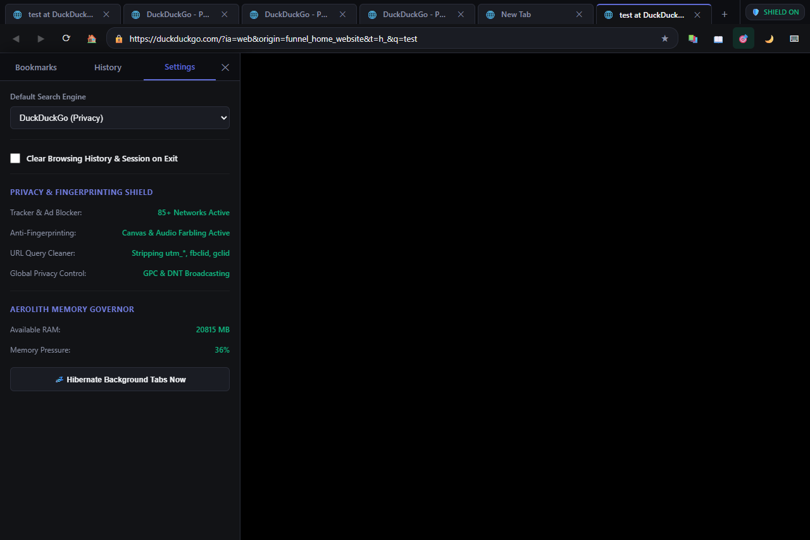
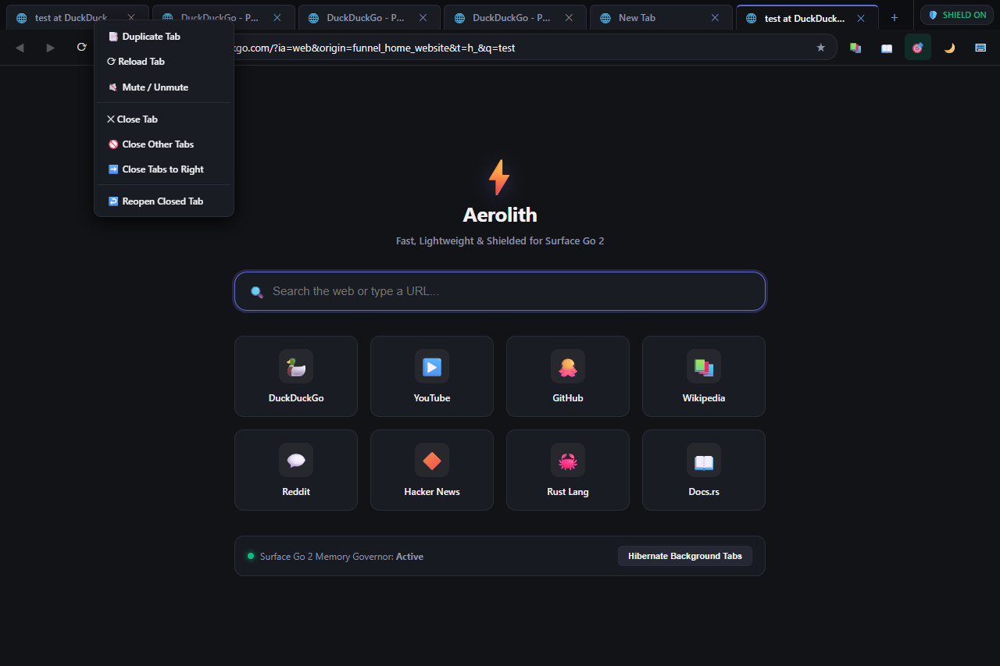

# Aerolith Browser

An ultra-lightweight, hardware-optimized web browser written in Rust, engineered for maximum privacy, speed, and resource efficiency across Windows, macOS, and Linux.

Designed originally for resource-constrained hardware such as the Microsoft Surface Go 2 (Intel Core m3-8100Y, 8 GB RAM), Aerolith delivers zero-bloat web browsing with hardware-level memory hibernation and top-tier anti-surveillance protections.

---

## Visual Demo



---

## Visual Showcase

### Offline Speed Dial & Instant Search
*Custom offline `about:home` dashboard with high-DPI scaling, prioritized bookmark shortcuts, and live memory governor status.*


### Privacy Shield & Settings Drawer
*Slide-over settings drawer featuring live hardware memory telemetry and real-time multi-layer anti-fingerprinting status.*


### Desktop Tab Management & Zoom Controls
*Full right-click context menu (Duplicate, Reload, Mute, Close Others, Reopen) and dynamic in-omnibox hardware zoom level badges.*


---

## Key Architectural Features

### 1. Multi-Layer Privacy & Anti-Surveillance Engine
- **URL Tracking Parameter Stripper:** Automatically strips pervasive tracking, click-attribution, and marketing query parameters (`utm_*`, `fbclid`, `gclid`, `gbraid`, `wbraid`, `msclkid`, `twclid`, `ttclid`, `igshid`, `yclid`, `mc_eid`, `_hsenc`, etc.) from typed URLs, live navigations, new tabs, and window popups.
- **Canvas Micro-Noise Farbling:** Injects subtle bitwise LSB farbling into `toDataURL`, `toBlob`, and `getImageData`, altering cryptographic checksums across tracking domains without visible distortion.
- **AudioContext Oscillator Noise Injection:** Blinds acoustic profiling by adding minute entropy variations to `AudioBuffer.prototype.getChannelData` and `AnalyserNode.prototype.getFloatFrequencyData`.
- **Hardware & Battery Profile Normalization:** Defeats entropy grouping by mocking `navigator.getBattery()` with static dummy states and standardizing `hardwareConcurrency = 4` and `deviceMemory = 8`.
- **WebRTC Local IP Leak Protection:** Intercepts ICE candidates (`typ host`) to drop private LAN subnets (`192.168.*`, `10.*`, `172.16–31.*`), preventing malicious scripts from mapping internal network topology.
- **Global Privacy Signals & Beacon Protection:** Injects and broadcasts `navigator.globalPrivacyControl = true`, `window.globalPrivacyControl = true`, and `navigator.doNotTrack = "1"`, while stripping `<a ping>` hyperlink auditing beacons.
- **85+ Network Filter:** Real-time interception of major ad networks, tracking telemetry, session replay scripts (Hotjar, Clarity, FullStory, Amplitude, Mixpanel), and attribution brokers (FingerprintJS, AppsFlyer, Branch.io).

### 2. Two-Tier Adaptive Tab Memory Governor
- **Tier 1 (Light Throttling @ 2 min):** Throttles `requestAnimationFrame` loops to 1 FPS and limits background timers, cutting background tab CPU wakeups to 0.
- **Tier 2 (Deep Hibernation @ 10 min or Low RAM):** Entirely drops the underlying WebView instance to reclaim physical memory (~0 MB RAM footprint per sleeping tab) while preserving scroll position and navigation state. Instant tap-to-wake restores the tab seamlessly.
- **Cross-Platform Memory Hooks:**
  - **Windows:** Win32 `kernel32` FFI integration via `CreateMemoryResourceNotification` and `GlobalMemoryStatusEx`.
  - **Linux:** Real-time `/proc/meminfo` parser.
  - **macOS:** Native `sysctl` and `mach/vm_stat` FFI with atomic `AtomicU64` total RAM caching.
- **Smart Sleep Exemptions:** Background audio playback (`HTMLMediaElement.play`) and dirty form inputs (`<input>`, `<textarea>`) are tracked via IPC and strictly exempt from hibernation.
- **Scroll Offset Restoration:** High-precision scroll position tracking (`window.scrollX`/`window.scrollY`) automatically restores viewport alignment on tab wake.

### 3. Dual-Layer Anti-Tracking & Ad-Blocking Pipeline
- **Layer 1 (Native Rust Navigation Trie):** Intercepts top-level and sub-frame navigations, popup window requests, and background requests in native Rust code, dropping known ad, tracking, telemetry, and malware hosts before socket allocation.
- **Layer 2 (In-Engine JS Interceptor):** Traps `window.fetch`, `XMLHttpRequest.prototype.open`, and `navigator.sendBeacon`, short-circuiting ad and tracking calls with synthetic HTTP 204 responses.
- **Cosmetic Filtering:** Injects scoped element-hiding CSS into document heads on load to eliminate ad placeholders.
- **Short-Form Video Interceptor:** Toggleable YouTube Shorts & Instagram Reels blocker automatically redirecting distraction feeds into standard video players.

### 4. Cross-Platform Parity (Windows, macOS, Linux)
- **Universal Shortcut Dispatcher:** Transparent modifier handling (`Cmd` on macOS, `Ctrl` on Windows/Linux) across all 14 keyboard shortcuts.
- **Platform-Standard AppData Directories:** Uses `%LOCALAPPDATA%` on Windows, `~/Library/Application Support` on macOS, and `$XDG_DATA_HOME` / `~/.local/share` on Linux.
- **Virtual Keyboard Autodetection:** Launches `TabTip.exe` / `osk.exe` on Windows, `AccessibilityKeyboard` on macOS, and `onboard` / `maliit-keyboard` on Linux.
- **Native Crash & Error Dialogs:** Direct fallback to `MessageBoxW` on Windows, `osascript` on macOS, and `zenity` / `kdialog` on Linux.

### 5. Resilient Embedded Storage (`redb`)
- Embedded ACID transactional key-value store (`aerolith_storage.redb`) with zero daemon processes.
- RFC 3986 URL authority credential sanitization (strips `user:pass@` while preserving legitimate query params).
- 15-second visit debouncing to prevent disk I/O thrashing on title changes.
- Multi-instance directory failover (`WebView2Data_<pid>`) preventing `0x800700AA` lock collisions.

---

## Building and Testing

### Prerequisites
- **Rust 1.85+** (`cargo`, `rustc`)
- **Windows:** Windows 10/11 with WebView2 Runtime
- **macOS:** macOS 11.0+ (WebKit built-in)
- **Linux:** WebKitGTK 4.0/4.1 (`libwebkit2gtk-4.1-dev` or `libwebkit2gtk-4.0-dev`)

### Running Automated Tests
```bash
cargo test
```
*Executes the complete 63-test automated unit test suite verifying cross-platform memory telemetry, anti-fingerprinting injections, tracking parameter stripping, high-DPI scaling, session serialization, and storage robustness.*

### Compiling Release Binary
```bash
cargo build --release
```
Produces an optimized, stripped GUI application binary with no console window overhead (`#![windows_subsystem = "windows"]`).
